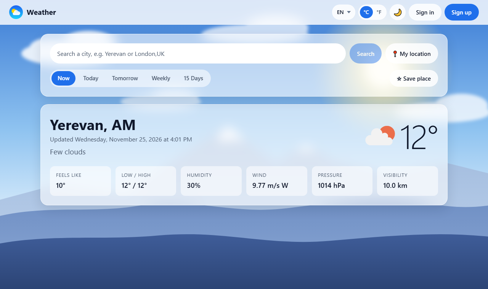
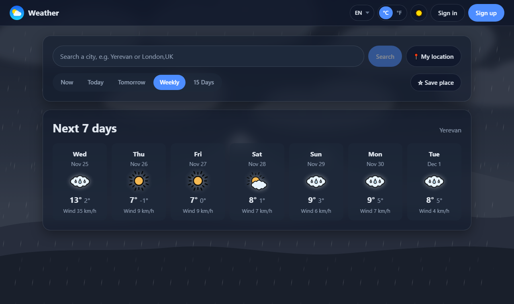
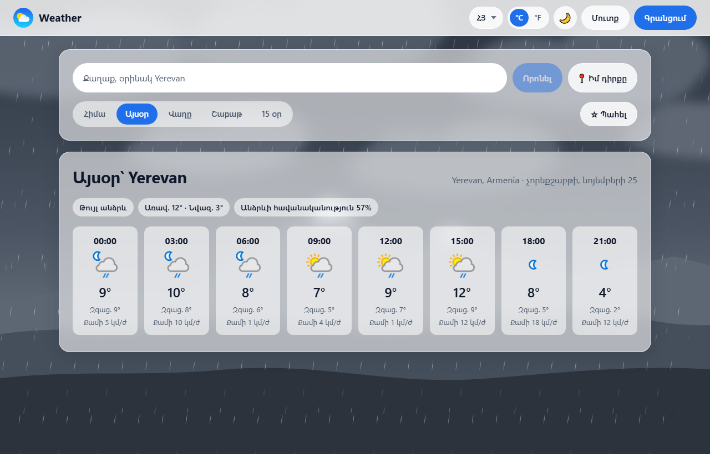
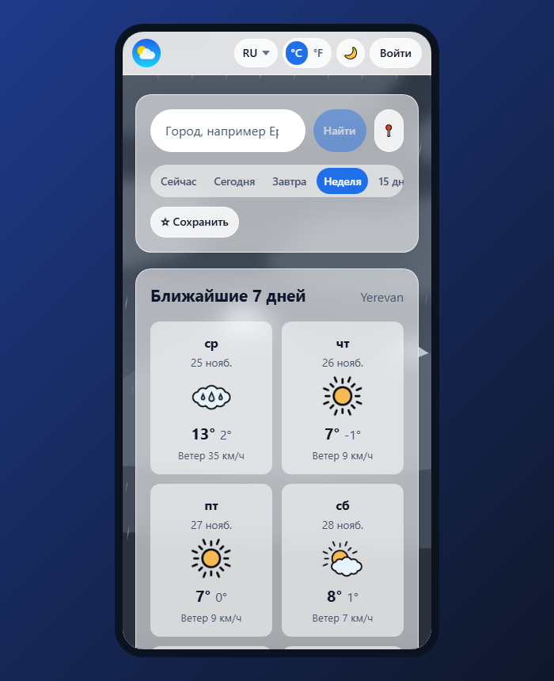
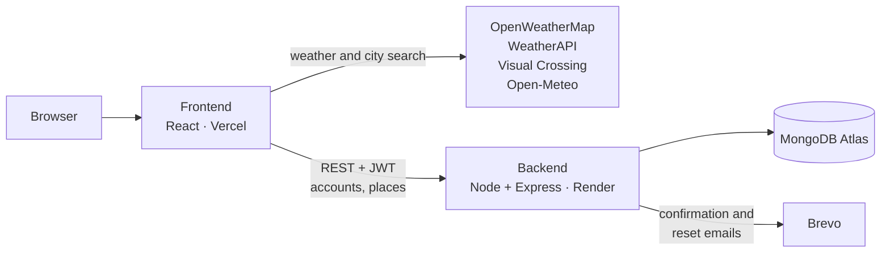

# 🌤️ Weather, anywhere

A full-stack weather app: current conditions, hourly forecasts for today and tomorrow, and a 15-day outlook for any city in the world. Users can create an account (with email confirmation) and save their favourite places.

**🔗 Live demo: [weather-app-seven-eosin-90.vercel.app](https://weather-app-seven-eosin-90.vercel.app)**

<p>
  
  
</p>
<p>
  
  
</p>

## Features

**Weather**
- Search any city with **suggestions while typing** (keyboard ↑ ↓ Enter supported)
- **📍 My location** – weather where you are (browser geolocation)
- Now · Today · Tomorrow (every 3 hours) · 7 days · 15 days · any single day
- **°C / °F** switch
- The **background follows the weather**: sunny, night with stars, clouds, falling rain, snow, fog

**Accounts**
- Sign up with **email confirmation**, sign in, **forgot / reset password** by email
- Save favourite places, remove them, delete the account

**Interface**
- **Three languages: English, Русский, Հայերեն** (remembered, first guess from the browser)
- **Dark mode** (follows the system setting on the first visit)
- Responsive: works on phones from 360 px wide
- Shareable URLs (`/now/Yerevan`, `/weekly/Paris,FR`) – refresh and Back work

## Tech stack

| Part | Technologies |
|---|---|
| Frontend | React 18, React Router 6, MobX, Material UI (forms), plain CSS with design tokens |
| Backend | Node.js 22, Express 4, MongoDB + Mongoose, JWT, bcrypt, Nodemailer / Brevo API, helmet, express-rate-limit |
| Weather data | OpenWeatherMap (now), WeatherAPI (hourly), Visual Crossing (15 days), Open-Meteo (city search) |
| Hosting | Vercel (frontend), Render (backend), MongoDB Atlas (database), Brevo (email) |
| Tests | Jest + React Testing Library |

## Architecture



The frontend calls the weather APIs directly; the backend only handles accounts, saved places and emails.

## Engineering highlights

- **Request cache** – weather answers are kept for 10 minutes and shared between tabs. The 7-day, 15-day and single-day pages use one request; Today and Tomorrow share another. Switching tabs is instant and costs no API calls.
- **Code splitting** – every page is lazy-loaded and weather icons are served as files instead of being bundled: the first download went from **180 kB to 74 kB** (gzipped).
- **Security**
  - JWT auth; the user always comes from the token, never from the request body
  - passwords hashed with bcrypt; email-confirmation and reset links are one-time and stored only as SHA-256 hashes
  - rate limits on sign-in, sign-up, reset and confirmation; helmet headers; 10 kB body limit
  - inputs checked against NoSQL injection (`{"$gt": ""}`)
  - the API never says whether an email is registered
- **Atomic database updates** – saved places use MongoDB `$push` / `$pull` in one query, so two requests at the same time can't overwrite each other.
- **Email on a free host** – Render's free plan blocks SMTP ports, so production email goes through Brevo's HTTPS API; locally it can use Gmail SMTP or just print the links to the console. `/health` reports the email status.
- **Translations without a library** – a 40-line `useT()` hook with three dictionaries. The weather APIs have no Armenian, so condition texts (“Light rain” → “Թույլ անձրև”) and Armenian dates are translated in the app. A test checks that all languages have exactly the same keys.
- **Friendly on a sleeping server** – Render's free plan sleeps after 15 minutes; the site wakes it up on load, and My account explains the wait instead of showing a silent spinner.

## API

| Method | Path | Auth | Purpose |
|---|---|---|---|
| POST | `/auth/signup` | – | create an account, send a confirmation email |
| POST | `/auth/verifyemail` | – | confirm the email with the one-time token |
| POST | `/auth/resendverification` | – | send the confirmation link again |
| POST | `/auth/signin` | – | returns a JWT (24 h) |
| POST | `/auth/forgotpassword` | – | email a one-time reset link |
| POST | `/auth/resetpassword` | – | set a new password with the reset token |
| GET | `/auth/myaccount` | JWT | account data and saved places |
| POST | `/auth/places` | JWT | save a place |
| POST | `/auth/deleteplaces` | JWT | remove a place |
| POST | `/auth/deleteaccount` | JWT | delete the account |
| GET | `/health` | – | server, database and email status |

## Project structure

```
back/                     Node + Express API
  index.js                server setup: security headers, CORS, routes, error handler
  router/router.js        routes + which ones need login / rate limits
  controller/             request handlers (sign up, sign in, places, emails...)
  models/User.js          Mongoose schema
  middleware/             JWT check, rate limits
  utils/mailer.js         email via Brevo API, SMTP or console
front/                    React app
  src/components/         pages and UI pieces
  src/helpers/hooks/      useWeather (cache), usePlace, useCitySuggestions
  src/state/              MobX stores (search, user, settings)
  src/i18n/               en / ru / hy texts and the useT() hook
  src/index.css           all styles, light and dark themes
docs/screenshots/         images used in this README
```

## Run it locally

Requirements: **Node.js 22** and a MongoDB database (a free [MongoDB Atlas](https://www.mongodb.com/atlas) cluster works).

```bash
git clone https://github.com/KarenAbazyan777/WeatherApp.git
cd WeatherApp

# Backend
cd back
cp .env.example .env      # fill in DB_URL and JWT_ACCESS_SECRET
npm install
npm run dev               # http://localhost:5000

# Frontend (second terminal)
cd front
cp .env.example .env      # add the three free weather API keys
npm install
npm start                 # http://localhost:3000
```

Email is optional: without it, confirmation and password-reset links are printed in the backend terminal. See `back/.env.example` for Brevo and Gmail settings.

## Tests

```bash
cd front
npm test
```

- **My account** – waits for a sleeping server, shows the explanation after 4 s, gives up with “Try again” after 75 s (fake timers)
- **Translations** – every language has the same keys and `{placeholders}`; weather texts and Armenian dates are translated correctly

## Deployment

| Service | What runs there | Notes |
|---|---|---|
| Vercel | frontend (`front/`) | `vercel.json` sends every path to `index.html` |
| Render | backend (`back/`) | Node 22, health check `/health`, `TRUST_PROXY=1` |
| MongoDB Atlas | database | network access open to the backend |
| Brevo | emails | HTTPS API, because Render's free plan blocks SMTP |
| UptimeRobot | pings `/health` every 5 min | keeps the free backend awake |

Every push to `main` deploys both parts automatically.

## Author

**Karen Abazyan** · [GitHub](https://github.com/KarenAbazyan777)
